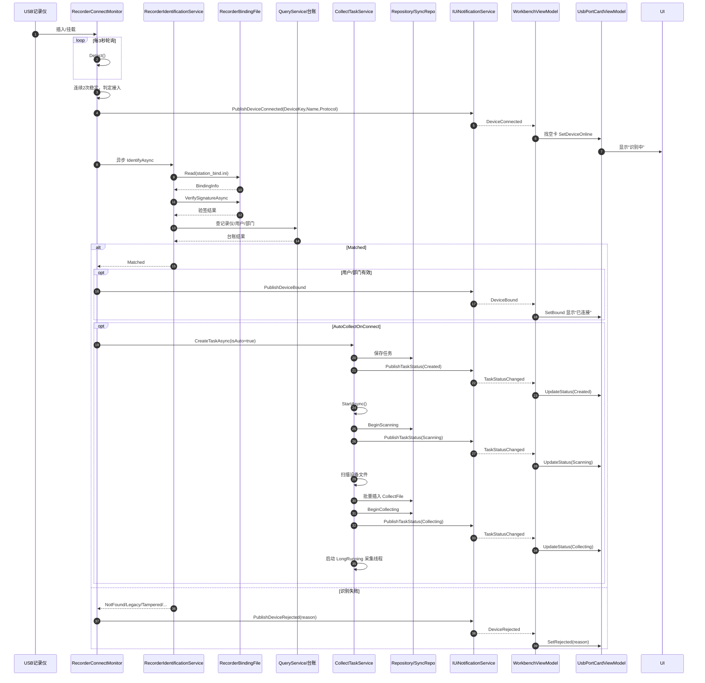
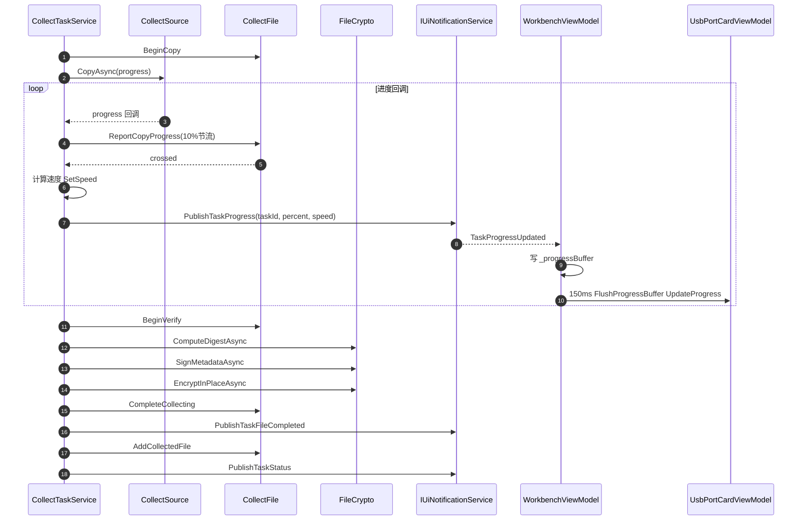
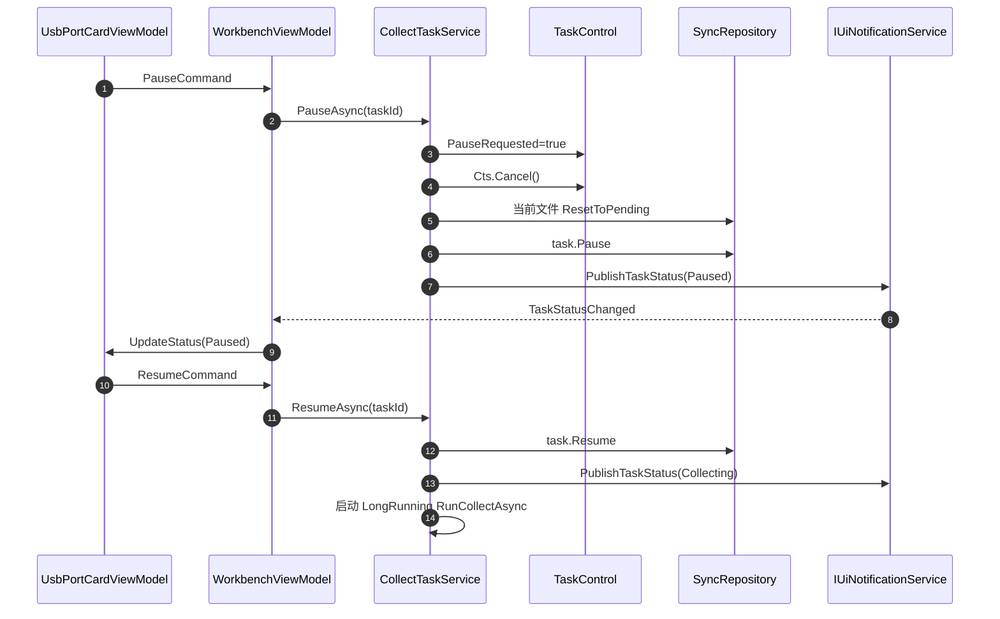
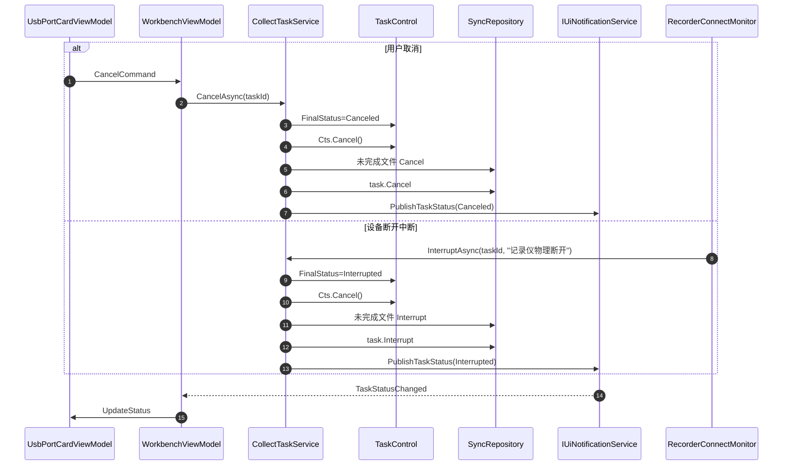
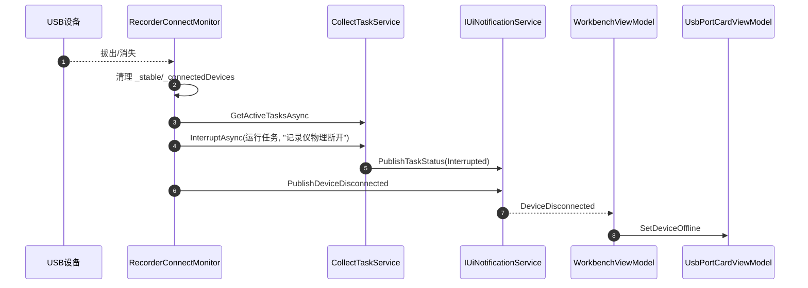
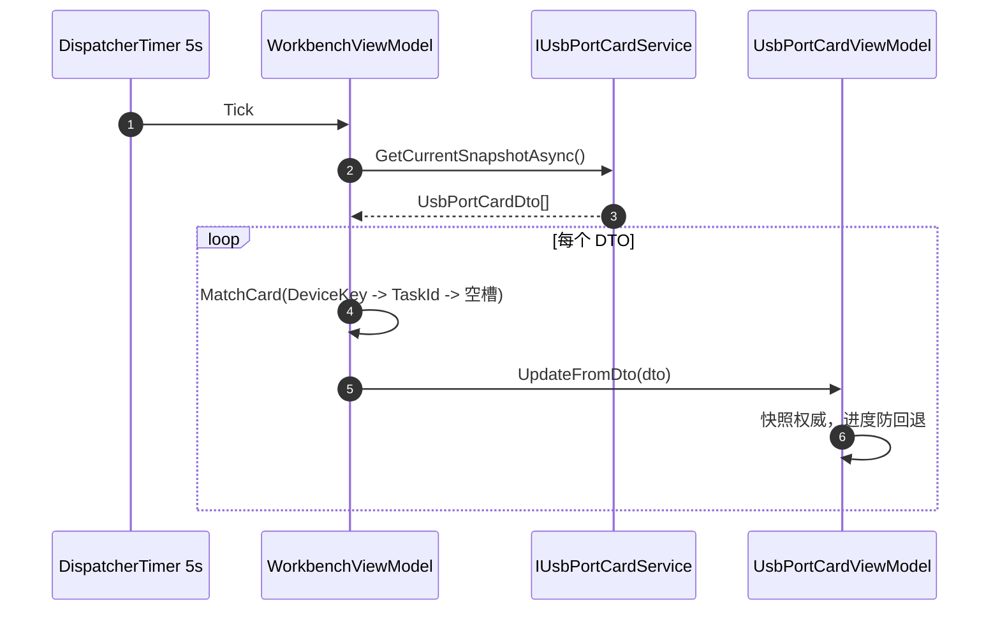

# Station 采集站：采集通道卡片事件与 UI 展示业务逻辑

> 适用技术栈：.NET 8 + Avalonia 12.0.5 + CommunityToolkit.Mvvm 8.4.1 + SqlSugar 5.1.4.216  
> 文档目标：整理采集通道卡片相关业务逻辑、事件链路、UI 联动与完整事件时序图。  
> 核心链路：USB 接入 → 识别 → 建任务 → 采集执行 → UI 通知 → 卡片刷新 → 快照兜底。

---

## 1. 总体链路

```text
USB 插入
   ↓
RecorderConnectMonitor 轮询检测
   ↓
连续稳定 N 次，判定接入
   ↓
发布 DeviceConnected UI 事件
   ↓
异步 RecorderIdentificationService 四层识别
   ↓
Matched：发布 DeviceBound / 自动创建采集任务
   ↓
CollectTaskService.CreateTaskAsync
   ↓
StartAsync：扫描 → 批量插入 CollectFile → BeginCollecting
   ↓
后台 LongRunning 采集线程
   ↓
CopyAsync → 进度回调 → PublishTaskProgress
   ↓
摘要 / 签名 / 加密 → CompleteCollecting
   ↓
PublishTaskStatus / PublishTaskFileCompleted
   ↓
WorkbenchViewModel 接收 UI 事件
   ↓
UsbPortCardViewModel 增量刷新卡片
   ↓
5 秒快照兜底修正
```

整体原则：

- **领域事件**负责业务联动：审计、同步、上传、聚合等。
- **UI 通知**负责界面刷新：状态、进度、设备接入/断开。
- **快照兜底 + 增量事件刷新 + 高频进度缓冲合并**共同保证 30 路 USB 场景下的 UI 稳定性。

---

## 2. 分层职责

| 层             | 关键类                                                       | 职责                                           |
| -------------- | ------------------------------------------------------------ | ---------------------------------------------- |
| Domain         | `CollectTask`、`CollectFile`                                 | 聚合根、状态机、不变量、领域事件               |
| Application    | `CollectTaskService`、`RecorderIdentificationService`、`RecorderBindingFile` | 采集任务编排、设备识别、绑定文件读写验签       |
| Infrastructure | `RecorderConnectMonitor`                                     | USB 设备轮询检测、稳定接入判定、断开检测       |
| Desktop VM     | `WorkbenchViewModel`、`UsbPortCardViewModel`                 | 30 路卡片管理、事件订阅、UI 状态映射、命令下发 |
| Desktop View   | `WorkbenchView.axaml`、`UsbPortCardView.axaml`               | UniformGrid 卡片布局、单卡状态/进度/按钮展示   |

注意：

- 你提供的 `UsbPortCardView.txt`、`WorkbenchView.txt` 实际内容已经是 Avalonia XAML。
- 应改名为 `.axaml`，并确保 `x:Class` 与 code-behind 一致。

---

## 3. 核心状态

### 3.1 设备链路状态 DeviceLinkState

| 状态        | 灯色         | 文本     | 触发              |
| ----------- | ------------ | -------- | ----------------- |
| `Offline`   | 灰 `#cbd5e1` | 空闲     | 初始 / 拔出       |
| `Verifying` | 黄 `#f59e0b` | 识别中   | `SetDeviceOnline` |
| `Bound`     | 绿 `#22c55e` | 已连接   | `SetBound`        |
| `Rejected`  | 红 `#ef4444` | 拒绝连接 | `SetRejected`     |

相关属性：

- `LinkBrush`
- `LinkText`
- `DeviceKey`
- `DeviceText`
- `DeviceSpaceText`
- `HasDeviceSpace`

### 3.2 采集任务状态 CollectTaskStatus

| 状态          | 文本   | 徽章色 | 可用命令                                |
| ------------- | ------ | ------ | --------------------------------------- |
| `Scanning`    | 扫描中 | 靛蓝   | `CanCancel`                             |
| `Collecting`  | 采集中 | 蓝     | `CanPause`、`CanCancel`、`CanPriority`  |
| `Paused`      | 已暂停 | 黄     | `CanResume`、`CanCancel`、`CanPriority` |
| `Failed`      | 故障   | 红     | `CanRetry`                              |
| `Completed`   | 已完成 | 绿     | 无                                      |
| `Canceled`    | 已取消 | 灰     | 无                                      |
| `Interrupted` | 已中断 | 黄褐   | 当前无，暂不可重试                      |
| `Created`     | 待开始 | 灰     | 无，当前无手动启动入口                  |

相关属性：

- `TaskStatus`
- `TaskId`
- `TaskNo`
- `StatusText`
- `StatusBadgeBrush`
- `StatusForeground`
- `StorageText`
- `Progress`
- `ProgressText`
- `SpeedText`
- `IsIdle`
- `Opacity`
- `IsEmergency`
- `AccentBrush`
- `CardBackground`

### 3.3 采集文件状态 CollectFileStatus

代码中出现：

- `Pending`
- `Copying`
- `Verifying`
- `Completed`
- `Failed`
- `Canceled`
- `Interrupted`

---

## 4. 设备接入与识别链路

### 4.1 USB 检测

`RecorderConnectMonitor` 是核心：

- 实现 `IDevicePresenceService` + `IHostedService`
- 每 **3 秒**轮询一次
- `SourceMode == "simulated"` 时不工作
- 检测器 `IRecorderDeviceDetector.Detect()` 返回原始设备
- 按设备 `Name` 分组，同物理设备多协议时：
  - 优先级：`UMS > MTP > 私有 SDK`
  - 统一 Key：`UNIFIED:{Name}`
- `_settlePolls = 2`：连续 2 次轮询稳定出现才判定接入
- 已连接设备放入 `_connectedDevices`
- 设备消失后：
  - 从 `_stable`、`_connectedDevices` 移除
  - 触发 `TriggerDisconnect`

### 4.2 接入处理

`HandleConnectAsync` 分两步：

1. **立即发布 UI 事件**
   - `PublishDeviceConnected(new DeviceConnectedEvent(...))`
   - 让界面瞬间显示“识别中”

2. **异步执行身份识别**
   - 创建 DI Scope
   - 取 `IRecorderIdentificationService`
   - 取 `ICollectTaskService`
   - 调 `IdentifyAsync(deviceInfo, device.Root, CancellationToken.None)`

识别成功 `Matched` 后：

- 取 `result.Recorder?.BoundUserId`
- 取 `result.Recorder?.DeptId`
- 二者都有值时：
  - `SetLinkState(device.Key, DeviceLinkState.Bound)`
  - `PublishDeviceBound(new DeviceBoundEvent(...))`
- 若 `_options.AutoCollectOnConnect == true`
  - 调 `collect.CreateTaskAsync(bound, isAuto: true)`

识别失败：

- `SetLinkState(device.Key, DeviceLinkState.Rejected)`
- `PublishDeviceRejected(new DeviceRejectedEvent(...))`
- 按 `RecorderIdentifyStatus` 给出原因：
  - `NotFound`：设备未绑定
  - `Legacy`：绑定文件旧格式
  - `Tampered`：绑定文件被篡改
  - `RecorderMissing`：记录仪不在台账/停用
  - `UserInactive`：用户不在册/禁用
  - `DeptInactive`：部门不在册/禁用
  - `Mismatch`：绑定信息与台账不一致

### 4.3 识别服务四层校验

`RecorderIdentificationService`：

0. **总开关**：`EnableBinding == false` → 直接 `Matched`
1. **读绑定文件**：`station_bind.ini`
   - 读不到 → `NotFound`
2. **MAC 验签**：`EnableSignature == true`
   - `Signature` 为空 → `Legacy`
   - 验签失败 → `Tampered`
3. **台账校验**：
   - 按 `binding.DeviceSerial` 查 `IRecorderQueryService`
   - 不存在/停用 → `RecorderMissing`
4. **用户/部门校验**：`EnableBindingValidation == true`
   - `binding.UserNo` 对应用户不存在/禁用 → `UserInactive`
   - `binding.DeptCode` 对应部门不存在/禁用 → `DeptInactive`
   - 全部通过 → `Matched`

### 4.4 设备断开

`TriggerDisconnect` 异步执行：

- `HandleDisconnectAsync`
  - 创建 Scope
  - 取 `ICollectTaskService`
  - `GetActiveTasksAsync()`
  - 按 `RecorderName == device.Name` 找运行任务
  - 找到则 `InterruptAsync(runningTask.TaskId, "记录仪物理断开")`
- 然后 `PublishDeviceDisconnected(new DeviceDisconnectedEvent(...))`

---

## 5. 采集任务生命周期

### 5.1 创建任务

`CollectTaskService.CreateTaskAsync`：

- 生成任务 ID、任务号
- `CollectTask.Create(...)`
- `_tasks.AddAsync`
- `PublishAndClearAsync`
- `_ui.PublishTaskStatus(...)`
- 若自动采集且 `AutoCollectOnConnect`：
  - 调 `StartAsync(task.Id)`

### 5.2 启动任务

`StartAsync` 主流程：

1. 授权检查 `_licenseService.IsValidNowAsync()`
2. 采集总控检查 `_collectControl.CollectingEnabled`
3. 加载任务，确认没有正在运行的 `_controls`
4. `task.BeginScanning(DateTime.Now)`
   - 更新仓储
   - 发布领域事件
   - `_ui.PublishTaskStatus`
5. 扫描设备文件：
   - `ICollectSourceProvider.GetFor(protocol)`
   - `ScanAsync`
   - 按文件名排序
6. 跳过已采集：
   - `_files.GetCompletedFingerprintsAsync`
   - 根据 `_options.SkipCollected`
7. 批量构造 `CollectFile`：
   - `CollectFile.Create(...)`
   - `_files.AddRangeAsync`
8. `task.BeginCollecting(...)`
   - 更新仓储
   - 发布领域事件
   - `_ui.PublishTaskStatus`
9. 创建 `TaskControl`
   - `Cts`
   - `PauseRequested`
   - `FinalStatus`
   - `CurrentFileId`
10. 启动后台长线程：
    - `Task.Factory.StartNew(..., TaskCreationOptions.LongRunning)`
    - 内部调用 `RunCollectAsync(taskId, control)`

### 5.3 后台采集主循环

`RunCollectAsync` 使用长连接仓储：

- `ICollectTaskSyncRepository`
- `ICollectFileSyncRepository`

循环处理 `pendingFiles`：

1. `file.BeginCopy(DateTime.Now)`
2. `fileSync.Update(file)`
3. 发布文件领域事件
4. `source.CopyAsync(...)`
   - 进度回调里：
     - `file.ReportCopyProgress(progress)`，聚合内 10% 节流
     - 计算速度
     - `task.SetSpeed`
     - `_ui.PublishTaskProgress(taskId, overall * 100, speed)`
     - 跨档时 `fileSync.Update(file)`
5. `file.BeginVerify()`
6. 校验文件大小
7. 摘要、签名、加密：
   - `_fileCrypto.ComputeDigestAsync`
   - `_fileCrypto.SignMetadataAsync`
   - `_fileCrypto.EncryptInPlaceAsync`
8. `file.CompleteCollecting(...)`
9. `fileSync.Update(file)`
10. 发布文件领域事件
11. `_ui.PublishTaskFileCompleted(taskId, file.Id, file.Status)`
12. `task.AddCollectedFile(file.Size, DateTime.Now)`
13. 发布任务领域事件
14. 注意：任务进度字段不直接写 DB，由 `ProgressAggregator` 合并

### 5.4 暂停 / 恢复 / 取消 / 中断

#### 暂停

`PauseAsync`：

- `control.PauseRequested = true`
- `control.Cts.Cancel()`

`FinalizeAsync` 检测到暂停请求：

- 若当前文件处于 `Copying/Verifying`：
  - `ResetToPending()`
  - 更新并发布事件
  - UI 发文件完成事件
- `task.Pause(DateTime.Now)`
- `taskSync.UpdateStateOnly(task)`
- 移除 `_controls`

#### 恢复

`ResumeAsync`：

- 加载任务
- 确认没有运行中控制块
- `task.Resume(DateTime.Now)`
- 更新仓储、发布领域事件、UI 状态
- 新建 `TaskControl`
- 再次启动 `RunCollectAsync`

#### 取消 / 中断

`CancelAsync` → `SetFinalAsync(..., Canceled, ...)`  
`InterruptAsync` → `SetFinalAsync(..., Interrupted, ...)`

有活动控制块时：

- 设置 `FinalStatus`
- 若有 reason，追加错误信息
- `control.Cts.Cancel()`

无活动控制块时：

- 直接对空闲任务执行终态
- 取消/中断未完成文件

`FinalizeAsync` 中：

- 若 `Interrupted`：未完成文件 `Interrupt("设备断开，采集中断")`
- 否则：未完成文件 `Cancel("任务已取消")`
- 任务终态：
  - `task.Interrupt`
  - 或 `task.Cancel`
  - 或 `task.Complete`
- 发布事件
- `_ui.PublishTaskStatus`
- 移除 `_controls`

### 5.5 紧急优先

`SetEmergencyAsync`：

- 若设为紧急且当前不是紧急：
  - `CountActiveEmergencyAsync`
  - 达到 `_options.MaxEmergencyTasks` 返回 `false`
- `task.MarkEmergency(isEmergency, DateTime.Now)`
- 更新仓储
- 发布领域事件
- `_ui.PublishTaskStatus(taskId, task.Status, task.IsEmergency)`

---

## 6. 事件与通知

当前实现是两条线：

| 类型     | 总线                     | 用途                             | 消费方               |
| -------- | ------------------------ | -------------------------------- | -------------------- |
| 领域事件 | `IDomainEventBus`        | 审计、同步、上传、聚合等业务联动 | 应用/基础设施处理器  |
| UI 通知  | `IUiNotificationService` | 界面实时刷新                     | `WorkbenchViewModel` |

`CollectTaskService` 中：

- `PublishAndClearAsync(...)` → 领域事件
- `_ui.PublishTaskStatus(...)`、`_ui.PublishTaskProgress(...)`、`_ui.PublishTaskFileCompleted(...)` → UI 通知

`WorkbenchViewModel` 只订阅 `IUiNotificationService`，不直接订阅领域事件。

UI 事件：

- `TaskProgressUpdated`
- `TaskStatusChanged`
- `DeviceConnected`
- `DeviceDisconnected`
- `DeviceBound`
- `DeviceRejected`

对应事件对象：

- `TaskProgressUpdatedEvent`
- `TaskStatusChangedEvent`
- `DeviceConnectedEvent`
- `DeviceDisconnectedEvent`
- `DeviceBoundEvent`
- `DeviceRejectedEvent`

明细窗口还会使用：

- `TaskFileCompleted` / `PublishTaskFileCompleted`

---

## 7. WorkbenchViewModel 的 UI 联动逻辑

### 7.1 初始化

- 注入：
  - `ISessionManager`
  - `ICollectTaskService`
  - `IOperationAccessService`
  - `IUsbPortCardService`
  - `IUiNotificationService`
  - `WindowModeOptions`
  - `CollectOptions`
- 生成 `PortCards`
- `EnsureCardLayout()` 按 `Rows * Columns` 创建卡片
- `CreateCard` 给每张卡绑定操作委托：
  - 暂停
  - 恢复
  - 取消
  - 重试
  - 优先
  - 明细
- 订阅 `_eventService` 各事件
- 订阅 `_sessions.SessionChanged`
- 启动两个 DispatcherTimer：
  - 心跳 5 秒：`RefreshSnapshotAsync`
  - 进度刷新 150ms：`FlushProgressBuffer`

### 7.2 快照兜底

`RefreshSnapshotAsync`：

- 调 `_cardService.GetCurrentSnapshotAsync()`
- 对每个 `UsbPortCardDto`
  - `MatchCard(dto)`
  - `UpdateFromDto(dto)`

`MatchCard` 三级匹配：

1. `DeviceKey`
2. `TaskId`
3. 空槽：`LinkState == Offline && TaskId is null`

### 7.3 高频进度

`OnTaskProgressUpdated`：

- 不直接更新 UI
- 写入 `_progressBuffer[taskId] = ProgressSnapshot`

`FlushProgressBuffer`：

- 每 150ms 执行
- 遍历 `_progressBuffer`
- `FindCardByTaskId(taskId)?.UpdateProgress(...)`

这是 30 路 USB 并发下避免 UI 线程压力的关键。

### 7.4 任务状态事件

`OnTaskStatusChanged`：

- 若在 UI 线程：直接 `ApplyStatus`
- 否则 `Dispatcher.UIThread.Post`
- `FindCardByTaskId(e.TaskId)?.UpdateStatus(e.Status, e.IsEmergency)`

### 7.5 设备事件

- `OnDeviceConnected`
  - 找 `LinkState == Offline && TaskId is null` 的空卡
  - `SetDeviceOnline(e.DeviceKey, e.DeviceName, e.Protocol)`
- `OnDeviceDisconnected`
  - `FindCardByDeviceKey(e.DeviceKey)?.SetDeviceOffline()`
- `OnDeviceBound`
  - `FindCardByDeviceKey(e.DeviceKey)?.SetBound()`
- `OnDeviceRejected`
  - `FindCardByDeviceKey(e.DeviceKey)?.SetRejected(e.Reason)`

### 7.6 用户操作

`OperateAsync`：

- 检查 `CanOperate`
- 检查 `card.TaskId`
- 调用 `ICollectTaskService`

`ToggleEmergencyAsync`：

- 调 `SetEmergencyAsync`
- 返回 `false` 时弹窗：紧急优先已达上限

`ShowTaskFilesAsync`：

- `GetTaskFilesAsync(taskId)`
- 创建 `TaskFilesViewModel`
- 打开 `TaskFilesWindow`
- 把 `_fileEvents` 转发给明细窗口

---

## 8. UsbPortCardViewModel 单卡状态机

### 8.1 设备维度

`DeviceLinkState`：

| 状态        | 灯色         | 文本     | 触发              |
| ----------- | ------------ | -------- | ----------------- |
| `Offline`   | 灰 `#cbd5e1` | 空闲     | 初始/拔出         |
| `Verifying` | 黄 `#f59e0b` | 识别中   | `SetDeviceOnline` |
| `Bound`     | 绿 `#22c55e` | 已连接   | `SetBound`        |
| `Rejected`  | 红 `#ef4444` | 拒绝连接 | `SetRejected`     |

### 8.2 任务维度

`CollectTaskStatus`：

| 状态          | 文本   | 徽章色 | 可用命令                                |
| ------------- | ------ | ------ | --------------------------------------- |
| `Scanning`    | 扫描中 | 靛蓝   | `CanCancel`                             |
| `Collecting`  | 采集中 | 蓝     | `CanPause`、`CanCancel`、`CanPriority`  |
| `Paused`      | 已暂停 | 黄     | `CanResume`、`CanCancel`、`CanPriority` |
| `Failed`      | 故障   | 红     | `CanRetry`                              |
| `Completed`   | 已完成 | 绿     | 无                                      |
| `Canceled`    | 已取消 | 灰     | 无                                      |
| `Interrupted` | 已中断 | 黄褐   | 当前不可重试                            |
| `Created`     | 待开始 | 灰     | 无                                      |

### 8.3 紧急优先

`IsEmergency` 影响：

- `AccentBrush`：红 / 蓝
- `CardBackground`：浅红 / 白
- `PriorityButtonText`：取消优先 / 优先
- `PriorityButtonBrush`：红 / 橙
- View 中显示 ⭐

### 8.4 卡片更新入口

| 方法               | 用途      | 特点                        |
| ------------------ | --------- | --------------------------- |
| `UpdateFromDto`    | 快照更新  | 快照权威，进度防回退        |
| `UpdateProgress`   | 高频进度  | 去噪：进度 0.05，速度 0.1MB |
| `UpdateStatus`     | 状态/紧急 | 事件触发                    |
| `SetDeviceOnline`  | 设备接入  | 进入识别中                  |
| `SetDeviceOffline` | 设备拔出  | 链路离线，无任务时任务归零  |
| `SetIdle`          | 整体归零  | 初始/清空                   |
| `SetBound`         | 绑定成功  | 已连接                      |
| `SetRejected`      | 拒绝      | 显示原因                    |
| `SetWarning`       | 警告      | 提示                        |
| `SetDeviceSpace`   | 设备空间  | 可用/总容量                 |
| `UpdateFromTask`   | 任务 DTO  | 直接应用任务数据            |

内部关键方法：

- `ApplyTaskData`：写任务、协议、自动/手动、扫描/已上传、进度、状态样式、紧急样式、命令通知
- `ApplyTaskIdle`：任务归零
- `ApplyStatusStyle`：状态 → 文本/颜色/Can*
- `ApplyLinkState`：链路 → 灯色/文本
- `UpdatePriorityPresentation`：紧急 → 颜色/按钮
- `NotifyCommands`：仅变化时 `NotifyCanExecuteChanged`

派生属性：

- `IsScanning`
- `IsCollecting`
- `IsPaused`
- `IsFailedState`
- `IsCompletedState`
- `IsPendingState`
- `HasTask`

通过：

- `OnTaskStatusChanged`
- `OnTaskIdChanged`

精准通知，避免全量刷新。

---

## 9. View 层绑定逻辑

### 9.1 WorkbenchView

- `ScrollViewer`
- `ItemsControl ItemsSource="{Binding PortCards}"`
- `ItemsPanel` 使用 `UniformGrid Rows/Columns`
- `ItemTemplate` 使用 `UsbPortCardView Margin="8"`
- 注释说明：Margin 8 = 卡片间距 16，必须与 code-behind 的 `GridSpacing / 2` 一致

### 9.2 UsbPortCardView

单卡结构：

- 外框 `Border`
  - `Classes.emergency` 绑定 `IsEmergency`
  - `Classes.idle-card` 绑定 `IsIdle`
  - `Opacity` 绑定 `Opacity`
  - 长按弹出右键菜单
- 右键菜单：
  - 查看明细
  - 暂停
  - 恢复
  - 取消
  - 重试
  - 优先
- 主 Grid：
  - 左状态竖条 `card-accent`
  - 行 0：端口号、设备灯、链路文本、紧急星标、任务状态徽章
  - 行 1：设备名、协议/采集模式
  - 行 2：操作人，当前占位
  - 行 3：设备空间 + 扫描/已上传，仅 `HasTask` 显示
  - 行 4：提示，`HasHint`
  - 行 5：进度条、速度、百分比
  - 行 6：操作按钮：
    - 暂停 `CanPause`
    - 恢复 `CanResume`
    - 取消 `CanCancel`
    - 重试 `CanRetry`
    - 优先 `CanPriority`
    - 明细 `!IsIdle`

---

## 10. 完整事件时序图

### 10.1 端到端总时序：USB 插入 → 识别 → 建任务 → 采集启动



### 10.2 采集执行与高频进度刷新



### 10.3 暂停 / 恢复时序



### 10.4 取消 / 中断时序



### 10.5 设备断开时序



### 10.6 快照兜底时序



---

## 11. 事件清单

| 事件                       | 来源                     | 消费方               | 作用                 |
| -------------------------- | ------------------------ | -------------------- | -------------------- |
| `DeviceConnectedEvent`     | `RecorderConnectMonitor` | `WorkbenchViewModel` | 找空卡，进入识别中   |
| `DeviceBoundEvent`         | `RecorderConnectMonitor` | `WorkbenchViewModel` | 卡片显示已连接       |
| `DeviceRejectedEvent`      | `RecorderConnectMonitor` | `WorkbenchViewModel` | 卡片显示拒绝原因     |
| `DeviceDisconnectedEvent`  | `RecorderConnectMonitor` | `WorkbenchViewModel` | 卡片离线             |
| `TaskStatusChangedEvent`   | `CollectTaskService`     | `WorkbenchViewModel` | 卡片状态、按钮可用性 |
| `TaskProgressUpdatedEvent` | `CollectTaskService`     | `WorkbenchViewModel` | 高频进度缓冲         |
| `TaskFileCompleted`        | `CollectTaskService`     | 明细窗口             | 文件级刷新           |

领域事件：

- 由聚合根 `Raise(...)`
- 应用服务持久化后 `PublishRangeAsync(...)`
- 用于审计、同步、上传、聚合等业务侧联动
- 不直接驱动 `WorkbenchViewModel` 卡片刷新

---

## 12. 关键规则与约束

1. **设备识别必须四层校验**
   - 总开关
   - 绑定文件存在性
   - MAC 验签
   - 台账 + 用户 + 部门

2. **只有 Matched 才允许采集**
   - 其他状态发布 `DeviceRejectedEvent`

3. **采集线程使用 LongRunning**
   - 避免线程池饥饿
   - 后台文件 I/O 可异步，长连接 Kdbndp 仓储保持同步

4. **30 路 USB 进度不能直接刷 UI**
   - 聚合内 10% 节流
   - UI 层 150ms 合并
   - `UpdateProgress` 再去噪

5. **快照 5 秒兜底**
   - 事件丢失或乱序时，快照修正最终状态

6. **进度防回退**
   - 同任务 DTO 进度落后时跳过写入

7. **UI 事件与领域事件分离**
   - 领域事件异步、业务导向
   - UI 通知同步、界面导向

8. **命令可用性集中由 Can* 控制**
   - `CanPause`
   - `CanResume`
   - `CanCancel`
   - `CanRetry`
   - `CanPriority`

---

## 13. 当前优化建议

1. **卡片与端口没有稳定映射**
   - 现在靠 `DeviceKey`、`TaskId`、空槽匹配。
   - 设备重连、多协议切换、统一 Key 变化时，卡片可能漂移。
   - 建议引入 `PortIndex / SlotId`，Workbench 维护 `DeviceKey -> Card` 稳定映射。

2. **快照与增量事件没有版本/时间戳**
   - 进度已做防回退。
   - 设备状态、任务状态没有防旧数据覆盖。
   - 建议事件和快照都带 `Version` 或 `Timestamp`，旧数据拒绝写入。

3. **中断状态不可重试**
   - `Interrupted` 当前没有 `CanRetry`。
   - 设备重新接入后，可能需要“恢复/重试”。

4. **`Created` 待开始没有启动入口**
   - 当前 `Created` 状态无按钮。
   - 若非自动采集，需要手动开始。

5. **操作人维度未填充**
   - `OperatorText`、`HasOperator` 是占位。
   - 可从任务 DTO 或识别结果补用户信息。

6. **无任务时设备空间不显示**
   - 行 3 绑定 `IsVisible="{Binding HasTask}"`。
   - 行 1 的设备空间绑定被注释。
   - 空闲设备接入后，容量信息看不到。

7. **异常静默较多**
   - 心跳刷新、操作命令、进度落库都有 `catch {}`。
   - 建议至少记录日志或给卡片 `Hint`。

8. **XAML 文件命名**
   - `UsbPortCardView.txt`、`WorkbenchView.txt` 应改为 `.axaml`。
   - 确保 `x:Class`、code-behind、资源样式都正确关联。

9. **`_fileEvents` 与 `_eventService` 重复**
   - `WorkbenchViewModel` 中两者是同一个实例。
   - 可简化为一个字段，明细窗口直接传 `_eventService`。

10. **状态到 UI 的映射可集中**
    - 现在 `ApplyStatusStyle`、按钮可见性、颜色都在 ViewModel 里。
    - 可抽成状态映射表或转换器，降低后续扩展成本。

---

## 14. 一句话总结

`RecorderConnectMonitor` 轮询发现设备 → `RecorderIdentificationService` 四层识别 → `CollectTaskService` 创建并启动采集任务 → 后台长线程按文件采集、校验、签名、加密 → 通过 `IUiNotificationService` 发状态/进度/设备事件 → `WorkbenchViewModel` 按 `TaskId/DeviceKey` 找卡片 → `UsbPortCardViewModel` 增量更新设备态、任务态、进度、按钮可用性 → 5 秒快照兜底修正。