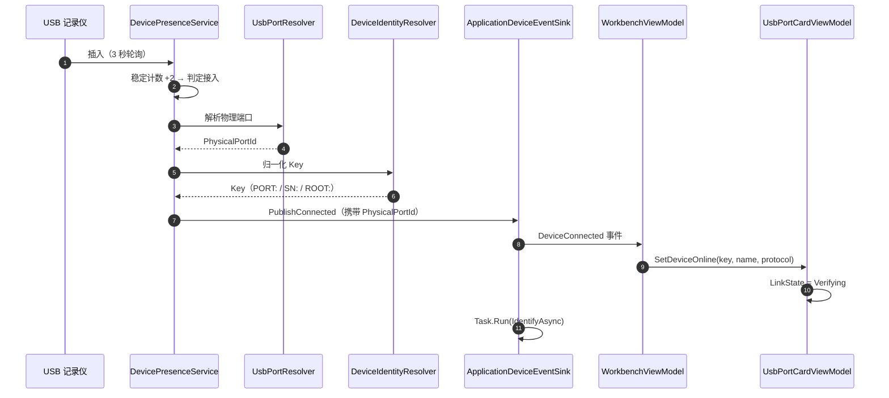
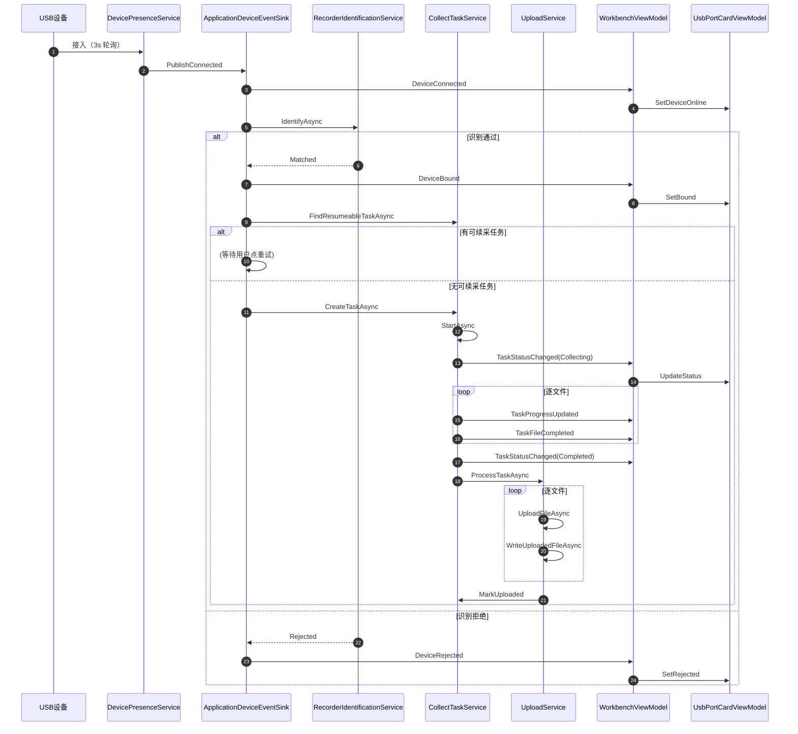
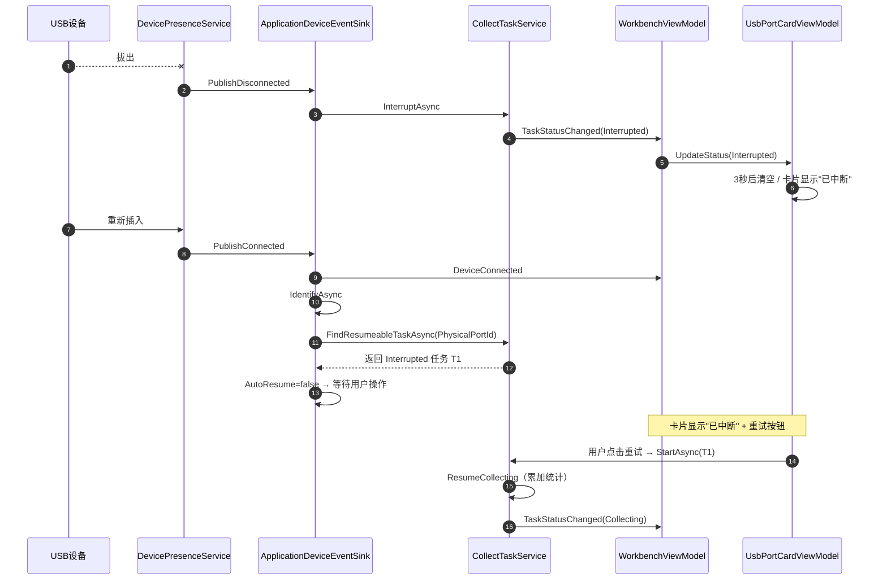

# Station 采集站 — 采集通道卡片功能说明与业务流程

> 版本：对应 DeviceRef 重构后的最终版本  
> 技术栈：.NET 8 + Avalonia 12.0.5 + CommunityToolkit.Mvvm 8.4.1 + SqlSugar 5.1.4.216  
> 适用平台：Windows / Linux / Kylin / UOS（单一 TFM `net8.0`，运行时判定）

---

## 一、概述

### 1.1 核心定位

采集通道卡片是工作台的核心 UI 单元，承担三件事：

1. **展示状态**：单个物理 USB 端口上的设备接入、识别、采集、上传全链路状态
2. **承载操作**：暂停 / 恢复 / 取消 / 重试 / 优先 / 明细 / 重试识别
3. **事件入口**：用户操作通过命令委托回到 `WorkbenchViewModel` 再调用应用服务

### 1.2 30 路卡片

- 工作台固定渲染 **30 张卡片**（由 `ISlotRouter.Capacity` 决定，默认 30）
- 布局：5 行 × 6 列（`Rows=5, Columns=6`）
- 每张卡片对应一个槽位（`SlotIndex` 0-based，`PortNumber` 1-based）

### 1.3 双模式

| 模式                   | 槽位分配                             | 换 USB 口        |
| ---------------------- | ------------------------------------ | ---------------- |
| **Fixed**（固定模式）  | 卡片 ↔ 物理端口 1:1，USB1 永远 `#01` | 卡片跟随物理端口 |
| **Pooled**（空闲模式） | 池化，谁先接入谁占空槽               | 卡片保持原槽位   |

模式在启动时读取 `station_info.slot_mode`，运行期修改需重启。

---

## 二、卡片功能说明

### 2.1 视觉结构

```
┌─┬──────────────────────────────────────────────────────┐
│ │  ● #01 已连接  ⭐               [采集中]              │  ← 行 0：端口号 + 设备灯 + 紧急星标 + 状态徽章
│ │  记录仪A · MTP · 自动采集                            │  ← 行 1：设备名 + 协议 + 采集模式
│ │  张三 / 技术部                                       │  ← 行 2：操作人（用户 / 部门）
│ │  可用 12.3 GB / 32 GB          扫描 120 · 已上传 45  │  ← 行 3：设备空间 + 任务进度
│ │  ⚠ 未映射端口 WIN:HUB0001:PORT0005（请配置映射表）    │  ← 行 4：提示信息（拒绝原因 / 未映射警告）
│ │  ▓▓▓▓▓▓▓▓░░░░░░░░  37%                             │  ← 行 5：进度条 + 速度 + 百分比
│ │  12.3 MB/s                                          │
│ │                          [暂停] [取消] [优先] [明细] │  ← 行 6：操作按钮
└─┴──────────────────────────────────────────────────────┘
```

左侧竖条 `card-accent`：蓝色（采集）/ 红色（紧急或故障）/ 灰色（空闲）

### 2.2 字段说明

| 行   | 字段       | 绑定属性                             | 说明                                            |
| ---- | ---------- | ------------------------------------ | ----------------------------------------------- |
| 0    | 端口号     | `PortText`                           | `#01`~`#30`；未映射时显示 `#??`                 |
| 0    | 设备灯     | `LinkBrush` / `LinkText`             | 灰=空闲 黄=识别中 绿=已连接 红=拒绝             |
| 0    | 紧急星标   | `IsEmergency`                        | ⭐ 显示时为紧急优先                              |
| 0    | 状态徽章   | `StatusText` / `StatusBadgeBrush`    | 见 §2.3                                         |
| 1    | 设备名     | `DeviceText`                         | 记录仪名（Connected 事件设置）                  |
| 1    | 协议+模式  | `MetaText`                           | `UMS · 自动采集` / `MTP · 手动采集`             |
| 2    | 操作人     | `OperatorText` / `HasOperator`       | 格式 `用户名 / 部门名`；无则隐藏                |
| 3    | 设备空间   | `DeviceSpaceText` / `HasDeviceSpace` | `可用 X / Y`；`GetDeviceSpace` 返回 null 时隐藏 |
| 3    | 任务进度   | `StorageText`                        | `扫描 N · 已上传 M`；无任务时隐藏               |
| 4    | 提示       | `HintText` / `HasHint`               | 拒绝原因、警告信息                              |
| 4    | 未映射提示 | `UnmappedText` / `IsUnmapped`        | Fixed 模式下端口未映射时显示                    |
| 5    | 进度条     | `Progress` / `ProgressText`          | 0~100，去噪 0.05                                |
| 5    | 速度       | `SpeedText`                          | 格式 `X.X MB/s`；去噪 0.1MB                     |
| 6    | 按钮       | `CanPause` 等                        | 见 §2.4                                         |

### 2.3 状态徽章

| 任务态              | 徽章文本 | 徽章颜色  | 前景色    |
| ------------------- | -------- | --------- | --------- |
| `Created`           | 待开始   | `#f1f5f9` | `#64748b` |
| `Scanning`          | 扫描中   | `#e0e7ff` | `#4338ca` |
| `Collecting`        | 采集中   | `#dbeafe` | `#1d4ed8` |
| `Paused`            | 已暂停   | `#fef3c7` | `#b45309` |
| `Completed`         | 已完成   | `#dcfce7` | `#15803d` |
| `Canceled`          | 已取消   | `#e2e8f0` | `#475569` |
| `Interrupted`       | 已中断   | `#fef3c7` | `#92400e` |
| `Failed`            | 故障     | `#fee2e2` | `#b91c1c` |
| 无任务 + 设备 Bound | 已绑定   | `#dcfce7` | `#15803d` |
| 无任务 + 无设备     | --       | `#f1f5f9` | `#94a3b8` |

### 2.4 操作按钮

| 按钮            | 显示条件           | 可用条件           | 行为                                      |
| --------------- | ------------------ | ------------------ | ----------------------------------------- |
| 暂停            | `CanPause`         | `CanPause`         | `PauseAsync(taskId)`                      |
| 恢复            | `CanResume`        | `CanResume`        | `ResumeAsync(taskId)`                     |
| 取消            | `CanCancel`        | `CanCancel`        | `CancelAsync(taskId)`                     |
| 重试            | `CanRetry`         | `CanRetry`         | `StartAsync(taskId)`                      |
| 优先 / 取消优先 | `CanPriority`      | `CanPriority`      | `SetEmergencyAsync(taskId, !IsEmergency)` |
| 明细            | `!IsIdle`          | `HasTask`          | 打开 `TaskFilesWindow`                    |
| 重试识别        | `CanRetryIdentify` | `CanRetryIdentify` | `RecheckAsync(deviceKey)`                 |

### 2.5 右键菜单

长按卡片（触屏）或右键（键鼠）弹出，菜单项与按钮一致：

```
查看明细
────────
暂停
恢复
取消
重试
优先 / 取消优先
```

---

## 三、状态机

### 3.1 设备链路态（`DeviceLinkState`）

```
        ┌──────────────────────────────────────┐
        │                                       │
        ▼                                       │
   ┌─────────┐  Connected   ┌─────────────┐   │ 识别通过
   │ Offline │─────────────▶│  Verifying  │───┼──────────▶ ┌───────┐
   │  空闲   │              │   识别中     │   │            │ Bound │
   └─────────┘              └─────────────┘   │            │已连接 │
        ▲                          │           │            └───────┘
        │                          │ 识别失败   │                │
        │ Disconnected             ▼            │                │
        │                    ┌──────────┐       │                │
        │                    │ Rejected │       │                │
        │                    │ 拒绝连接  │       │                │
        │                    └──────────┘       │                │
        │                          │            │                │
        └──────────────────────────┴────────────┴────────────────┘
                     设备断开 / 重试识别
```

| 状态        | 灯色         | 文本     | 何时进入                  |
| ----------- | ------------ | -------- | ------------------------- |
| `Offline`   | 灰 `#cbd5e1` | 空闲     | 初始 / 断开 / 归零        |
| `Verifying` | 黄 `#f59e0b` | 识别中   | `DeviceConnected` 事件    |
| `Bound`     | 绿 `#22c55e` | 已连接   | 识别通过 `DeviceBound`    |
| `Rejected`  | 红 `#ef4444` | 拒绝连接 | 识别拒绝 `DeviceRejected` |

### 3.2 采集任务态（`CollectTaskStatus`）

```
   ┌─────────┐
   │ Created │  待开始
   └────┬────┘
        │ StartAsync
        ▼
   ┌──────────┐
   │ Scanning │  扫描中
   └────┬─────┘
        │ 扫描完成
        ▼
   ┌────────────┐  PauseAsync  ┌────────┐
   │ Collecting │─────────────▶│ Paused │
   │  采集中    │◀─────────────│已暂停  │
   └────┬───────┘  ResumeAsync └────────┘
        │
        ├─── 全部完成 ──────▶ ┌───────────┐
        │                    │ Completed │ 已完成
        │                    └───────────┘
        ├─── CancelAsync ───▶ ┌──────────┐
        │                    │ Canceled │ 已取消
        │                    └──────────┘
        ├─── 设备断开 ───────▶ ┌─────────────┐
        │  InterruptAsync    │ Interrupted │ 已中断
        │                    └─────────────┘
        └─── 未捕获异常 ─────▶ ┌────────┐
                             │ Failed │ 故障
                             └────────┘

     Interrupted / Failed / Paused 均可 StartAsync 续采
```

### 3.3 采集文件态（`CollectFileStatus`）

| 状态          | 说明   | 可进入下一态                                 |
| ------------- | ------ | -------------------------------------------- |
| `Pending`     | 待采集 | → `Copying`                                  |
| `Copying`     | 复制中 | → `Verifying` / `Failed` / `Pending`（暂停） |
| `Verifying`   | 校验中 | → `Completed` / `Failed`                     |
| `Completed`   | 已完成 | —                                            |
| `Failed`      | 失败   | 重试 → `Pending`（重置）                     |
| `Canceled`    | 已取消 | —                                            |
| `Interrupted` | 已中断 | 重试 → `Pending`                             |

---

## 四、核心架构

### 4.1 分层架构

```
┌─────────────────────────────────────────────────────────┐
│ Station.Desktop（UI 层）                                │
│  WorkbenchViewModel + UsbPortCardViewModel              │
│  UsbPortCardView.axaml + WorkbenchView.axaml            │
└────────────────────┬────────────────────────────────────┘
                     │ 事件 / 命令
                     ▼
┌─────────────────────────────────────────────────────────┐
│ Station.Application（应用层）                            │
│  CollectTaskService + UsbPortCardService                │
│  ApplicationDeviceEventSink + TaskDeviceFactory         │
│  StartupRepairService + RecorderIdentificationService   │
└────────────────────┬────────────────────────────────────┘
                     │ DomainEvent / UI 通知
                     ▼
┌─────────────────────────────────────────────────────────┐
│ Station.Domain（领域层）                                │
│  CollectTask + CollectFile + DeviceRef                  │
│  状态机 / 不变量 / 领域事件                              │
└────────────────────┬────────────────────────────────────┘
                     │
                     ▼
┌─────────────────────────────────────────────────────────┐
│ Station.Infrastructure / Station.Device.Runtime         │
│  持久化 / 事件总线 / 设备检测 / 文件系统                 │
└─────────────────────────────────────────────────────────┘
```

### 4.2 关键类型

| 类型                   | 位置                               | 职责                                    |
| ---------------------- | ---------------------------------- | --------------------------------------- |
| `DetectedDevice`       | `Station.Device.Detection`         | 探测结果（设备层，纯物理）              |
| `BoundDevice`          | `Station.Application.Recorders`    | 识别结果（应用层，含 User/Dept）        |
| `DeviceRef`            | `Station.Domain.Collecting`        | 设备引用值对象（Domain 层，持久化快照） |
| `CollectTask`          | `Station.Domain.Collecting`        | 采集任务聚合根                          |
| `CollectFile`          | `Station.Domain.Collecting`        | 采集文件聚合根                          |
| `UsbPortCardDto`       | `Station.Application.UsbPortCards` | 卡片快照 DTO                            |
| `UsbPortCardViewModel` | `Station.Desktop.ViewModels`       | 单卡 VM                                 |
| `WorkbenchViewModel`   | `Station.Desktop.ViewModels`       | 工作台 VM（30 卡容器）                  |

### 4.3 关键接口

| 接口                      | 位置                               | 职责                     |
| ------------------------- | ---------------------------------- | ------------------------ |
| `ICollectTaskService`     | `Station.Application.Collecting`   | 采集任务应用服务         |
| `IUsbPortCardService`     | `Station.Application.UsbPortCards` | 卡片快照查询             |
| `ISlotRouter`             | `Station.Application.UsbPortCards` | 槽位路由（Fixed/Pooled） |
| `IUsbPortMapService`      | `Station.Application.UsbPortCards` | 端口映射表               |
| `IDevicePresenceService`  | `Station.Device.Detection`         | 设备在线服务             |
| `IDeviceFileSystem`       | `Station.Device.FileSystem`        | 设备文件系统             |
| `IUsbPortResolver`        | `Station.Device.Port`              | 物理端口解析             |
| `IDeviceIdentityResolver` | `Station.Device.Identity`          | 身份归一                 |

---

## 五、业务流程

### 5.1 设备接入主流程



### 5.2 识别流程（四层校验）

```
识别入口：ApplicationDeviceEventSink.IdentifyAsync(DetectedDevice)
    │
    ▼
┌─────────────────────────────────────────────┐
│ 0 层：总开关 EnableBinding                   │
│    false → 直接 Matched，跳过后续             │
└────────────────┬────────────────────────────┘
                 ▼
┌─────────────────────────────────────────────┐
│ 1 层：读 station_bind.ini                    │
│    不存在 → NotFound                         │
└────────────────┬────────────────────────────┘
                 ▼
┌─────────────────────────────────────────────┐
│ 2 层：MAC 验签（HMAC-SM3）                    │
│    Signature 为空 → Legacy                   │
│    验签失败 → Tampered                        │
└────────────────┬────────────────────────────┘
                 ▼
┌─────────────────────────────────────────────┐
│ 3 层：台账校验 GetBySerialAsync              │
│    不存在 / 已停用 → RecorderMissing          │
│    序列号不一致 → Mismatch                    │
└────────────────┬────────────────────────────┘
                 ▼
┌─────────────────────────────────────────────┐
│ 4 层：用户 / 部门校验                        │
│    用户不在册/禁用 → UserInactive             │
│    部门不在册/禁用 → DeptInactive             │
└────────────────┬────────────────────────────┘
                 ▼
             Matched
                 │
                 ▼
    发布 DeviceBoundEvent（User/Dept/UserName/DeptName）
    或 DeviceRejectedEvent（拒绝原因）
```

### 5.3 建任务 / 续采判定（混合续采策略）

```
识别结果 Matched
    │
    ▼
发布 DeviceBoundEvent（UI 显示"已连接"）
    │
    ▼
调用 FindResumeableTaskAsync(PhysicalPortId)
    │
    ├─── 找到可续采任务（Paused / Interrupted / Failed）
    │       │
    │       ▼
    │    AutoResumeInterruptedOnReconnect ?
    │       │
    │       ├─ true  → 自动 ResumeAsync(taskId)
    │       └─ false → 卡片显示"已中断/已暂停" + 重试按钮（等用户操作）
    │       │
    │       └─ 不建新任务
    │
    └─── 未找到
            │
            ▼
        AutoCollectOnConnect ?
            │
            ├─ true  → CreateTaskAsync（建新任务 → 自动采集）
            └─ false → 卡片显示"已绑定"，等用户手动开始
```

### 5.4 采集执行流程

```
StartAsync(taskId)
    │
    ├─ 校验授权 + 采集开关
    ├─ 加载任务（区分新建/续采）
    ├─ BeginScanning（状态：Scanning）
    │
    ├─ TaskDeviceFactory.FromCollectTask(task)  ← 统一构造 DetectedDevice
    │
    ├─ ScanAsync(device)  ← 扫描设备文件
    ├─ 查已 Completed 指纹
    ├─ 批量创建 CollectFile（只对新 fingerprint）
    │
    ├─ 新建：BeginCollecting(totalFiles, ...)
    ├─ 续采：ResumeCollecting(newPendingFiles, ...)  ← 累加统计
    │
    └─ 启动 LongRunning 后台线程
            │
            ▼
       RunCollectAsync(taskId, control)
            │
            ├─ 逐文件处理循环：
            │     │
            │     ├─ BeginCopy → fileSync.Update → 事件
            │     ├─ CopyAsync（进度回调 → ReportCopyProgress 10% 节流）
            │     │     └─ 进度事件 _ui.PublishTaskProgress(portId, version)
            │     ├─ BeginVerify
            │     ├─ 校验大小
            │     ├─ ComputeDigestAsync（SM3）
            │     ├─ SignMetadataAsync（可选 SM2）
            │     ├─ EncryptInPlaceAsync（可选 SM4）
            │     ├─ CompleteCollecting
            │     ├─ 事件 + _ui.PublishTaskFileCompleted
            │     └─ task.AddCollectedFile
            │
            └─ FinalizeAsync
                    │
                    ├─ 暂停分支：当前文件 ResetToPending → task.Pause
                    ├─ 终态分支：未完成文件 Interrupt/Cancel
                    ├─ 任务 Complete/Interrupt/Cancel
                    └─ TryErase（可选）
```

### 5.5 上传流程

```
UploadService.ProcessTaskAsync(taskId)
    │
    ├─ 加载任务（必须 Status = Completed）
    ├─ 查 pendingFiles（SyncStatus = Pending）
    │
    ├─ 逐文件：
    │     ├─ 校验本地缓存存在
    │     ├─ 加密文件解密（Plaintext 模式）
    │     ├─ ResetForRetry → BeginUpload
    │     ├─ StorageService.UploadFileAsync
    │     │     ├─ 分片
    │     │     ├─ 重试
    │     │     └─ 熔断检测
    │     ├─ 成功：CompleteUpload + 写 UploadedFile 台账
    │     │     └─ task.AddUploadedFile(fileSize)
    │     └─ 失败：FailUpload + 计数
    │
    └─ 任务收尾：
          ├─ 失败 > 0 → MarkUploadFailed
          ├─ 全部成功 → MarkUploaded（设置 LedgeredAt）
          └─ 熔断 → MarkUploadFailed("存储熔断中")
```

### 5.6 设备断开流程

```
DevicePresenceService.Check() 检测到设备消失
    │
    ├─ 清理 _stable / _connected / _portCache
    ├─ PublishDisconnected(DeviceDisconnectedEvent)
    │
    ▼
ApplicationDeviceEventSink.PublishDisconnected
    │
    ├─ Task.Run(OnDisconnectedAsync)：
    │     └─ collect.InterruptAsync(runningTaskId, "记录仪物理断开")
    │           └─ 任务 → Interrupted
    │
    └─ _ui.PublishDeviceDisconnected
            │
            ▼
    WorkbenchViewModel.OnDeviceDisconnected
            │
            ├─ card.SetDeviceOffline()
            │     ├─ LinkState = Offline
            │     ├─ 无任务：立即 ApplyTaskIdle
            │     └─ 有任务：启动 3 秒延迟清空定时器
            │
            └─ _cardService.EvictSpaceCache(deviceKey)  ← 主动清空间缓存
```

### 5.7 程序重启恢复流程

```
程序启动
    │
    ▼
App.OnShellOpened
    │
    ├─ RunStartupFlowAsync：
    │     ├─ IStationInfoService.RefreshAsync
    │     ├─ IStorageConfigStore.SeedIfEmptyAsync
    │     │
    │     ├─ ★ StartupRepairService.RepairAsync：
    │     │     └─ 查询 Scanning/Collecting 任务 → 逐个 InterruptAsync("程序异常退出")
    │     │
    │     └─ 自检
    │
    └─ IDevicePresenceService.BeginPolling()  ← Workbench 就绪后才启动轮询
```

**续采策略在重启后的表现**：

| 崩溃前状态   | 重启后状态    | 用户操作                       |
| ------------ | ------------- | ------------------------------ |
| `Created`    | `Created`     | 点击开始                       |
| `Scanning`   | `Interrupted` | 点击重试（续采）或取消（重来） |
| `Collecting` | `Interrupted` | 点击重试（续采）或取消（重来） |
| `Paused`     | `Paused`      | 点击恢复                       |
| 终态         | 终态          | 无需处理                       |

### 5.8 优雅关闭流程

```
用户点击窗口关闭
    │
    ▼
desktop.ShutdownRequested 事件
    │
    ├─ collect.PauseAllAsync(10s)：
    │     ├─ 对 _controls 中所有 taskId 调 PauseAsync
    │     │     └─ 设置 PauseRequested=true + Cts.Cancel
    │     ├─ 轮询等待 _controls 清空（最多 10 秒）
    │     └─ 超时未完成 → 记录告警
    │
    ├─ _host.StopAsync(5s)
    └─ _host.Dispose()
```

**为什么用 PauseAll 而不是 InterruptAll**：  
采集支持断点续传（`CollectFile` 有 `Pending` 状态），Pause 后重启可继续采集，用户体验更佳。

---

## 六、槽位路由

### 6.1 Fixed 模式

**卡片 ↔ 物理端口 1:1**，USB1 永远显示 `#01`。

```
DeviceKey = "PORT:WIN:HUB0001:PORT0003"
    │
    ▼
FixedSlotRouter.ResolveSlotForDevice
    │
    ├─ 提取 PhysicalPortId = "WIN:HUB0001:PORT0003"
    ├─ 查映射表 portToSlot[PhysicalPortId] = 2  （1-based → 0-based 转 2）
    └─ 返回槽位 2
```

**未映射端口**：
- `ResolveSlotForDevice` 返回 null
- `WorkbenchViewModel` 找空闲卡片显示，但 `IsUnmapped=true`
- 卡片显示 `#??` + 橙色警告文字

### 6.2 Pooled 模式

**池化分配**，先到先占。

```
PooledSlotRouter.ResolveSlotForDevice
    │
    ├─ 查 _deviceKeyToSlot 缓存
    ├─ 无缓存 → _freeSlots.TryDequeue → 分配槽位
    └─ 缓存 deviceKey → slot
```

**设备断开**：`ReleaseSlot` 归还队列，清 `_deviceKeyToSlot` / `_taskIdToSlot`。

### 6.3 任务兜底路由

`UsbPortCardService.GetCurrentSnapshotAsync` 组装任务时：

```
ResolveSlotForTask(taskId) 返回 null
    │
    ▼
兜底：从 task.PhysicalPortId 反推 deviceKey = "PORT:{PhysicalPortId}"
    │
    ▼
ResolveSlotForDevice(deviceKey) 再次尝试
    │
    ├─ 命中 → BindTask(taskId, slot)
    └─ 未命中 → 跳过（任务暂不关联卡片，等下次快照或事件触发）
```

---

## 七、事件与通知

### 7.1 事件类型

| 事件                       | 性质 | 来源                         | 消费方                            |
| -------------------------- | ---- | ---------------------------- | --------------------------------- |
| `DeviceConnectedEvent`     | 物理 | `DevicePresenceService`      | `ApplicationDeviceEventSink` → UI |
| `DeviceDisconnectedEvent`  | 物理 | `DevicePresenceService`      | `ApplicationDeviceEventSink` → UI |
| `DeviceBoundEvent`         | 业务 | `ApplicationDeviceEventSink` | UI                                |
| `DeviceRejectedEvent`      | 业务 | `ApplicationDeviceEventSink` | UI                                |
| `TaskStatusChangedEvent`   | 业务 | `CollectTaskService`         | UI                                |
| `TaskProgressUpdatedEvent` | 业务 | `CollectTaskService`         | UI                                |
| `TaskFileCompletedEvent`   | 业务 | `CollectTaskService`         | UI / TaskFilesWindow              |

### 7.2 版本号仲裁

**目的**：防止旧事件 / 旧快照覆盖新状态。

| 版本来源                                                   | 生成规则                                                |
| ---------------------------------------------------------- | ------------------------------------------------------- |
| `TaskStatusChangedEvent.Version`                           | `CollectTaskService.NextUiVersion(taskId)` 单调递增     |
| `UsbPortCardDto.Version`                                   | `_collectTaskService.GetUiVersion(taskId)` 读取当前版本 |
| `DeviceBoundEvent.Version` / `DeviceRejectedEvent.Version` | `ApplicationDeviceEventSink.NextVersion()` 全局递增     |

**卡片侧仲裁规则**：

```
if (version > 0 && version < _lastTaskVersion) return;  // 旧事件，丢弃
if (version > 0) _lastTaskVersion = version;
```

`version == 0` 视为"兼容模式"，总是接受。

### 7.3 快照兜底

- **5 秒心跳**：`WorkbenchViewModel` 每 5 秒调 `_cardService.GetCurrentSnapshotAsync()`
- **快照数据源**：`IDevicePresenceService.GetConnectedDevices()` + `ICollectTaskService.GetActiveTasksAsync()`
- **快照只携带物理态**：`LinkState` 仅 `Offline` / `Verifying`；`Bound` / `Rejected` 由事件流驱动
- **快照不覆盖业务态**：`ShouldApplySnapshotLinkState` 规则——`Verifying` 快照不能覆盖 `Bound` / `Rejected`

---

## 八、关键设计

### 8.1 DeviceRef 值对象

**为什么需要**：

- `DetectedDevice` 是探测时产物，跨进程丢失
- `CollectTask` 是持久化聚合根，需要"设备快照"
- Domain 不能依赖 `Station.Device`

**解决方案**：Domain 定义 `DeviceRef` 值对象，包含 6 个字段：

```
Key（路由标识）+ PhysicalPortId + Serial + Root + Name + Protocol
```

**持久化方式**：拆列（`device_key` / `physical_port_id` / `recorder_serial` / `source_root` / `recorder_name` / `protocol`）

**执行时还原**：`TaskDeviceFactory.FromCollectTask(task)` → `DetectedDevice`

### 8.2 跨进程恢复

**问题**：进程重启后需要重建 `DetectedDevice` 执行任务。

**方案**：

1. `CollectTask.Device`（`DeviceRef` 值对象）持久化到 DB
2. 应用服务统一用 `TaskDeviceFactory.FromCollectTask(task)` 构造
3. 历史数据兜底：`device_key` 为空时按 `PhysicalPortId > Serial > Root` 规则拼

**不变式**：`PhysicalPortId != null` 时，`DeviceKey` 必须以 `PORT:{PhysicalPortId}` 开头（保证路由一致）。

### 8.3 磁盘空间缓存

**目的**：避免 5 秒心跳每次都调 WPD / libmtp（慢速系统调用）。

**规则**：

- `UsbPortCardService._spaceCache`（`ConcurrentDictionary<string, SpaceSnapshot>`）
- TTL 15 秒
- 设备断开时 `EvictSpaceCache(deviceKey)` 主动清缓存
- 失败结果也缓存（避免频繁重试慢速 MTP）

**跨平台实现**：

| 协议 | 平台    | 实现                                                         |
| ---- | ------- | ------------------------------------------------------------ |
| UMS  | 任意    | `DriveInfo`                                                  |
| MTP  | Windows | WPD `WPD_STORAGE_CAPACITY` / `WPD_STORAGE_FREE_SPACE_IN_BYTES` |
| MTP  | Linux   | libmtp `storage.MaxCapacity` / `FreeSpaceInBytes`            |

### 8.4 防抖与性能

| 机制               | 参数                       | 作用                        |
| ------------------ | -------------------------- | --------------------------- |
| 设备稳定判定       | 连续 2 次轮询（默认）      | 避免挂载瞬态触发接入        |
| 每 Tick 最大处理数 | 10（内部常量）             | 30 路同时插入时分批处理     |
| 进度合并           | 150ms（`DispatcherTimer`） | 高频进度事件不刷爆 UI       |
| 聚合内 10% 节流    | `ReportCopyProgress`       | 每 10% 进度才写一次 DB      |
| 速度去噪           | 0.1 MB                     | 避免频繁刷新                |
| 快照心跳           | 5 秒                       | 兜底事件丢失                |
| 端口解析缓存       | 60 秒（Resolver 内部）     | 避免重复调 SetupAPI / sysfs |
| 空间查询缓存       | 15 秒（Service 层）        | 避免重复调 WPD / libmtp     |

---

## 九、用户操作手册

### 9.1 正常采集（无可续采任务）

```
1. 插入设备
2. 卡片自动显示"识别中" → "已连接" → "采集中"
3. 观察进度条与速度
4. 完成后卡片显示"已完成"
5. 后台自动上传（若配置）
```

### 9.2 中断后续采

```
1. 采集中设备断开 → 卡片显示"已中断"
2. 重新插入同一 USB 口
3. 系统检测到可续采任务 → 卡片显示"已中断" + 重试按钮
4. 用户点击"重试"
5. 任务从 Pending 文件继续采集（已完成的不重采）
6. 完成后卡片显示"已完成"
```

### 9.3 中断后重来

```
1. 卡片显示"已中断"
2. 用户点击"取消" → 任务变 Canceled
3. 拔掉设备
4. 重新插入
5. 系统检测无可续采任务 → 自动建新任务 T2
6. T2 走完整扫描（跳过 fingerprint 已完成的文件）
```

### 9.4 拒绝识别后重试

```
1. 设备识别失败 → 卡片显示"拒绝连接" + 拒绝原因 + 重试识别按钮
2. 用户处理问题（重新绑定 / 联系管理员）
3. 点击"重试识别"
4. 卡片变"识别中" → 重新走识别流程
```

### 9.5 文件替换场景

**注意**：如果设备上的文件被替换（内容变了，文件名没变），但任务状态是 `Interrupted`，用户点击"重试"时的行为：

- 新 fingerprint 不匹配旧 `Completed` → 作为新 `CollectFile` 采集
- 但任务统计字段（`TotalFiles` / `CollectedFiles`）会累加，UI 明细可能显示重复文件名

**推荐做法**：如果确认文件被替换，**先点"取消"再拔插**，建新任务走完整扫描。

---

## 十、配置文件

### 10.1 `appsettings.json`

```json
{
  "Station": {
    "DeviceDetection": {
      "SourceMode": "Mixed",
      "PollIntervalSeconds": 3,
      "SettlePolls": 2,
      "UmsRootOverride": null
    },
    "DeviceTransport": {
      "CacheDirectory": "D:\\Station\\Cache"
    },
    "UsbPortMap": {
      "Enable": true,
      "Layout": "RowMajor",
      "Mapping": {
        "WIN:HUB0001:PORT0001": 1,
        "WIN:HUB0001:PORT0002": 2,
        "LIN:1-2.3": 3
      }
    },
    "Collect": {
      "AutoCollectOnConnect": true,
      "AutoResumeInterruptedOnReconnect": false,
      "SkipCollected": true,
      "EncryptCache": true,
      "EraseAfterComplete": false,
      "MaxEmergencyTasks": 3
    },
    "Storage": {
      "Target": "Local",
      "DirectoryTemplate": "{station}/{yyyy}/{MM}/{dd}/{recorder}/{user}/{ext}",
      "RetryCount": 3,
      "RemoteContentMode": "Plaintext",
      "EnableFileSignature": true
    }
  }
}
```

### 10.2 关键配置项

| 配置项                                     | 默认值      | 说明                                  |
| ------------------------------------------ | ----------- | ------------------------------------- |
| `DeviceDetection.SourceMode`               | `Mixed`     | `Ums` / `Mtp` / `Mixed` / `Simulated` |
| `DeviceDetection.PollIntervalSeconds`      | 3           | 轮询间隔                              |
| `UsbPortMap.Mapping`                       | 空          | 物理端口 → 1-30 序号                  |
| `Collect.AutoCollectOnConnect`             | true        | 设备接入后自动建任务采集              |
| `Collect.AutoResumeInterruptedOnReconnect` | **false**   | 自动续采中断任务（推荐 false）        |
| `Collect.SkipCollected`                    | true        | 跳过已采集文件（按 fingerprint）      |
| `Collect.MaxEmergencyTasks`                | 3           | 紧急优先上限                          |
| `Storage.RemoteContentMode`                | `Plaintext` | 上传明文 / 密文                       |

---

## 十一、数据库表

### 11.1 采集卡片相关表

| 表名                    | 用途       | 关键字段                                                     |
| ----------------------- | ---------- | ------------------------------------------------------------ |
| `station_collect_task`  | 采集任务   | `device_key` / `physical_port_id` / `recorder_serial` / `source_root` / `recorder_name` / `protocol` / `sync_status` / `ledgered_at` |
| `station_collect_file`  | 采集文件   | `fingerprint` / `status` / `progress` / `speed`              |
| `station_uploaded_file` | 已上传台账 | `local_file_id` / `remote_path` / `content_digest`           |
| `station_info`          | 站点配置   | `slot_mode` / `slot_capacity`                                |

### 11.2 新增列（相对上一版）

| 表                     | 列            | 类型           | 说明         |
| ---------------------- | ------------- | -------------- | ------------ |
| `station_collect_task` | `device_key`  | `varchar(128)` | 设备路由标识 |
| `station_collect_task` | `ledgered_at` | `datetime`     | 台账记账时间 |

SqlSugar CodeFirst 自动加列，无需手动 SQL。

---

## 十二、代码索引

### 12.1 关键文件

| 层             | 文件                                                         | 说明             |
| -------------- | ------------------------------------------------------------ | ---------------- |
| Domain         | `Station.Domain/Collecting/CollectTask.cs`                   | 任务聚合根       |
| Domain         | `Station.Domain/Collecting/CollectFile.cs`                   | 文件聚合根       |
| Domain         | `Station.Domain/Collecting/DeviceRef.cs`                     | 设备引用值对象   |
| Contracts      | `Station.Contracts/CollectTaskStatus.cs`                     | 任务状态枚举     |
| Contracts      | `Station.Contracts/DeviceLinkState.cs`                       | 链路状态枚举     |
| Application    | `Station.Application/Collecting/CollectTaskService.cs`       | 采集任务服务     |
| Application    | `Station.Application/Collecting/TaskDeviceFactory.cs`        | 统一工厂         |
| Application    | `Station.Application/Collecting/StartupRepairService.cs`     | 启动修复         |
| Application    | `Station.Application/UsbPortCards/UsbPortCardService.cs`     | 快照服务         |
| Application    | `Station.Application/UsbPortCards/ISlotRouter.cs`            | 槽位路由契约     |
| Application    | `Station.Application/DeviceIntegration/ApplicationDeviceEventSink.cs` | 设备事件粘合     |
| Infrastructure | `Station.Infrastructure/UsbPortCards/FixedSlotRouter.cs`     | Fixed 实现       |
| Infrastructure | `Station.Infrastructure/UsbPortCards/PooledSlotRouter.cs`    | Pooled 实现      |
| Infrastructure | `Station.Infrastructure/Persistence/Mapping/CollectTaskMapper.cs` | 双向映射         |
| Device         | `Station.Device/Detection/IDevicePresenceService.cs`         | 设备在线契约     |
| Device.Runtime | `Station.Device.Runtime/Detection/DevicePresenceService.cs`  | 设备在线实现     |
| Device.Runtime | `Station.Device.Runtime/Port/WindowsPortResolver.cs`         | Windows 端口解析 |
| Device.Runtime | `Station.Device.Runtime/Port/LinuxPortResolver.cs`           | Linux 端口解析   |
| Desktop        | `Station.Desktop/ViewModels/WorkbenchViewModel.cs`           | 工作台 VM        |
| Desktop        | `Station.Desktop/ViewModels/UsbPortCardViewModel.cs`         | 单卡 VM          |
| Desktop        | `Station.Desktop/Presentation/UiStateMap.cs`                 | 状态映射表       |
| Desktop        | `Station.Desktop/Views/UsbPortCardView.axaml`                | 单卡视图         |

### 12.2 关键方法

| 方法                                         | 位置           | 说明                          |
| -------------------------------------------- | -------------- | ----------------------------- |
| `CollectTask.Create`                         | Domain         | 创建任务（含 `DeviceRef`）    |
| `CollectTask.BeginScanning`                  | Domain         | 进入扫描阶段                  |
| `CollectTask.BeginCollecting`                | Domain         | 新建任务开始采集              |
| `CollectTask.ResumeCollecting`               | Domain         | 续采累加统计                  |
| `CollectTask.MarkUploaded`                   | Domain         | 上传完成 + 台账记账           |
| `TaskDeviceFactory.FromCollectTask`          | Application    | 从聚合根构造 `DetectedDevice` |
| `CollectTaskService.StartAsync`              | Application    | 启动 / 续采                   |
| `CollectTaskService.FindResumeableTaskAsync` | Application    | 查可续采任务                  |
| `CollectTaskService.PauseAllAsync`           | Application    | 优雅关闭批量暂停              |
| `StartupRepairService.RepairAsync`           | Application    | 启动修复                      |
| `UsbPortCardService.GetCurrentSnapshotAsync` | Application    | 卡片快照                      |
| `DevicePresenceService.BeginPolling`         | Device.Runtime | 延迟启动轮询                  |
| `UsbPortCardViewModel.UpdateFromDto`         | Desktop        | 快照更新 + 版本仲裁           |
| `UsbPortCardViewModel.SetDeviceOffline`      | Desktop        | 设备断开（3 秒延迟清空）      |

---

## 附录 A：常见问题排查

| 现象                       | 可能原因                                 | 排查方向                                           |
| -------------------------- | ---------------------------------------- | -------------------------------------------------- |
| 卡片显示 `#??`             | 物理端口未解析 / 未映射                  | 检查 `PhysicalPortId` 日志；检查映射表配置         |
| 卡片空白不显示             | `GridHeight=0` / `Capacity=0` / 数据源空 | 检查 `BuildFixedLayout` 日志                       |
| 设备接入后卡片一直"识别中" | 识别异常 / 事件丢失                      | 检查 `ApplicationDeviceEventSink` 日志             |
| 任务状态"采集中"但无进度   | 后台线程异常 / 设备断开                  | 检查 `RunCollectAsync` 日志                        |
| 重启后任务卡死"采集中"     | `StartupRepairService` 未执行            | 检查 `App.OnShellOpened` 流程                      |
| 断线重插出现两个任务       | 混合续采策略未生效                       | 检查 `FindResumeableTaskAsync`                     |
| 重试识别按钮不可点         | `CanRetryIdentify` 属性变化未通知命令    | 检查 `OnCanRetryIdentifyChanged`                   |
| 磁盘空间不显示             | `GetDeviceSpace` 返回 null               | 检查 `IDeviceFileSystem.GetDeviceSpace` 实现       |
| 操作人"占位"               | `CollectTaskService.ToDto` 占位符        | 后续迭代补 `OperatorUserName` / `OperatorDeptName` |

---

## 附录 B：事件时序图

### B.1 设备接入 → 建任务 → 采集 → 上传



### B.2 断线 → 重插 → 续采



---

**文档结束**